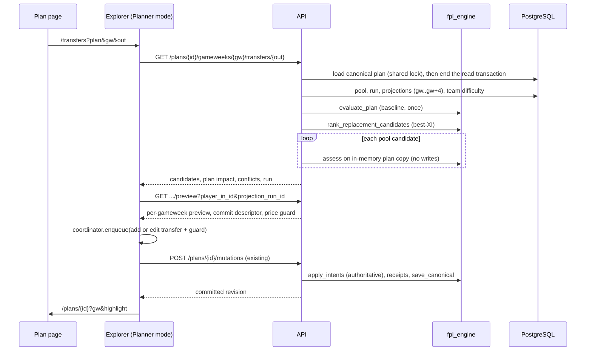

# Implementation Plan: Planner Transfer Workflow

**Branch**: `feature/planner-transfer-workflow` | **Date**: 2026-10-28 | **Spec**: [spec.md](spec.md)

**Input**: Feature specification from `specs/003-planner-transfer-workflow/spec.md` (clarifications Q-1 to Q-8 resolved). Supporting design: [research.md](research.md), [data-model.md](data-model.md), [contracts/](contracts/), [quickstart.md](quickstart.md), [current-state-assessment.md](current-state-assessment.md).

**Scope of this document**: design only. No application code, migration or task list is produced here (`/speckit-tasks` comes next). Evidence marked "measured" comes from a throwaway micro-benchmark of pure engine code on the development machine (no database; noisy; not a substitute for the verification gate in [quickstart.md](quickstart.md)).

## Summary

Two independent capabilities on the existing Planner foundations, with **no database schema change and no new dependency**.

**A. Planner-aware Transfer Explorer.** A new read-only, plan-scoped evaluation service ranks and previews replacements for one player in one plan gameweek. It reuses, rather than re-implements: the candidate pool rules, `rank_replacement_candidates` (best-XI gain), the projection repositories, `evaluate_plan` (authoritative replay), and the acceptance rules inside `apply_intents`. Hypothetical transfers are evaluated on in-memory copies of the canonical `Plan`; nothing is persisted. Confirming goes through the existing `POST /plans/{id}/mutations` (`add_transfer` / `edit_transfer`), extended with a compare-only price guard and a server-side selectability rule. The Explorer page gains a Planner mode selected by URL parameters; My Team mode is untouched.

**B. Duplicate Plan.** A single-transaction service locks the source plan, verifies revision and pending-edit state, remaps every internal identity in the canonical `Plan` with one pure function, allocates the `(option N)` name under a transaction-scoped advisory lock, and writes the copy with the existing `create` + `save_canonical` path (stored selling prices copied verbatim). The Plan page gets a `Duplicate Plan` control gated on the autosave coordinator.

## Technical Context

**Language/Version**: Python 3.12.15 (api, fpl_engine; mise-pinned), TypeScript 5.6 strict with Next.js 15.0.0 / React 18.3.1 (web), Node 22.7.0, pnpm 9.9.0, uv 0.5.24.

**Primary Dependencies**: Existing only: FastAPI 0.114.1, Pydantic 2.9.2, SQLAlchemy 2.0.34 + psycopg 3.2.1, Alembic (no new revision), Vitest 2, Testing Library, Playwright 1.46. **No new dependency.**

**Storage**: PostgreSQL 16 (Docker Compose locally). **Schema unchanged**; Alembic head stays `c6f91a2d83b0`. Name allocation uses `pg_advisory_xact_lock` (Postgres-only, already the only supported database: JSONB columns).

**Testing**: pytest for `packages/fpl_engine` and `apps/api` (guarded PostgreSQL integration via `TEST_DATABASE_URL`, `RUN_DB_TESTS=1`, isolated-schema fixtures such as `planner_session`); Vitest component tests; Playwright journeys following `.github/skills/ui-browser-verification`.

**Target Platform**: Local hybrid dev (host-run Next.js and FastAPI, Dockerized PostgreSQL).

**Project Type**: Web application in a pnpm/uv monorepo: `apps/web`, `apps/api`, `packages/fpl_engine`.

**Performance Goals**: SC-014: candidate list within 3 s, preview within 2 s on a full-season dataset with an 8-gameweek plan (38-gameweek plan measured, not gated).

**Constraints**: Authoritative rules only in `fpl_engine`; exact integer-tenths money; no writes on read paths; My Team mode behaviour and tests unchanged; single Planner writer; database safety rules in `AGENTS.md`.

**Scale/Scope**: One manager; up to 38 gameweeks and 15 players per plan; candidate pool up to roughly 300 players per position; one projection run per request.

## Constitution Check

*GATE: must pass before research; re-checked after design.*

| Principle | Assessment | Evidence in this design |
|---|---|---|
| I. Domain correctness and boundaries | Pass | Legality, accounting, plan impact and remapping live in `fpl_engine` (pure, no FastAPI). The API layer supplies data and orchestration. The Explorer reuses the same acceptance logic as `apply_intents`; the browser only re-presents server results (FR-045). Selectability is enforced in the shared mutation path. |
| II. Human ownership | Pass | Significant choices are listed under "Decisions Requiring Approval". |
| III. Small reviewable slices | Pass | Eight independently testable slices are derivable; duplication is independent of the Explorer. |
| IV. Test at the owning layer | Pass | Test ownership table below. |
| V. Independent verification | Pass | Verification gates in [quickstart.md](quickstart.md); `code-review` skill before completion; equivalence test between the read-only verdict and the real mutation. |
| VI. Browser verification | Pass | Durable Playwright journeys at 1440 and 390 widths; isolated preview per the skill. |
| VII. Safe database testing | Pass | Integration tests use `TEST_DATABASE_URL`, `ensure_test_database_url` and isolated schemas; read endpoints never write; no development-data mutation. |
| VIII. No silent scope expansion | Pass with noted touches | Three small, justified edits to Phase 002 code are called out explicitly (coordinator `abandon`, shared departure-guard hook, plan-page header move). No Phase 004 work. |
| IX. Acceptance criteria first | Pass | Governed by spec FR/SC; approach, assumptions and risks stated here. |
| X. Final review and gates | Planned | `make lint typecheck test test-integration`, web build, browser journeys, final diff review. |

**Post-design re-check**: no violation introduced; Complexity Tracking is empty.

## Architecture

### Reuse map

| Need | Reused as-is | Added or extended (smallest change) |
|---|---|---|
| Authoritative plan replay | `fpl_engine.planning.evaluate.evaluate_plan` | none |
| Candidate acceptance rules | the new-diagnostic and new-or-worsened-shortfall logic inside `validate_candidate` | extract into a pure non-raising function; `validate_candidate` calls it and raises exactly as today (behaviour-identical) |
| Candidate pool | `candidate_pool_exclusion`, `incoming_pool_exclusion` | extract the selectability branch into `incoming_selectability_exclusion` (same precedence) |
| Best-XI ranking | `rank_replacement_candidates` | none: called with the plan's gameweek-N squad and projections sliced from gameweek N; its budget and club-limit legality output is discarded because the plan assessment decides legality |
| Selling price | `fpl_engine.planning.prices.selling_price_tenths`, `DecisionSale` | none |
| Scoring | `fpl_engine.rules.score_gameweek`, `chip_states` | none |
| Persisting a transfer | `POST /plans/{id}/mutations`, `add_transfer`, `edit_transfer`, receipts, `PlanSaveCoordinator` | optional price-guard fields on the two intents; selectability check in `_capture`; coordinator `abandon()` |
| Projection access | `ProjectionRunRepository`, `MyTeamProjectionRepository.list_player_fixture_projections_for_run` | optional `min_gameweek` and `max_gameweek` filter |
| Persisting a whole plan | `PlanRepository.create`, `save_canonical`, `load_canonical` | `load_decision_sales`, family-name query, advisory-lock helper |
| Explorer UI parts | `HorizonSelector`, `ProjectionRunBadge`, `OutgoingPlayerSelector`, `describeLegalityReasons`, `playingStatusWarning`, `SquadPlayerCard` (already has `transferHref`) | Planner-mode components under `components/transfers/planner/` |

### Data flow: Planner-mode Explorer



### How hypothetical transfers are evaluated without modifying persisted plans

1. **Read once, release the lock.** `PlanRepository.load_canonical` takes a shared row lock. The service ends its read transaction immediately after loading, so autosave writers are never blocked while candidates are computed. The response carries `plan.revision`; stale results are caught at confirm time by `expected_revision`.
2. **Immutable inputs.** `Plan`, `Boundary`, `GameweekDecision` and `TransferDecision` are frozen dataclasses. A candidate is `dataclasses.replace(plan, gameweeks=...)` with one extra (or replaced) `TransferDecision` built from the candidate's quote and a deterministic `uuid5` identity. No repository method is called with it; there are no receipts, no flush, no session writes. Tests assert the input plan is unchanged and that database row counts, `revision`, `updated_at` and My Team rows are identical before and after (SC-004).
3. **The same operation the user will confirm.** The Explorer response includes the exact intent (`add_transfer` or `edit_transfer`) and the rule that picks it: if the outgoing player's ownership in the displayed gameweek was acquired by a decision in that same gameweek, replace that decision; otherwise add. The browser submits that descriptor, so the add-versus-edit rule exists once, server-side, and matches the existing inline picker.
4. **Authoritative verdict, non-raising.** `validate_candidate` today evaluates before and after and raises at the first problem. It is split into (a) a pure function returning every introduced diagnostic and every new or worsened shortfall, and (b) the raising wrapper. `apply_intents` (the commit path) keeps calling the wrapper, so commit behaviour is unchanged. The Explorer calls (a) with a baseline evaluation computed once. `confirmable` is therefore true exactly when `apply_intents` would not reject the candidate. An equivalence test runs both over every pool candidate of reference plans (SC-003).
5. **Why not call `apply_intents` per candidate.** It raises at the first rejection (hiding which gameweek conflicts and how many problems there are), re-evaluates the baseline each time, and returns no per-gameweek detail. The shared extraction gives the same rules without those limits.

**Conflict classification.** From the candidate replay: a diagnostic or shortfall in the selected gameweek makes the candidate `unavailable`; a first diagnostic or shortfall at a later gameweek makes it `blocked_by_later_decision`, identifying that gameweek and (when present) the decision. Values are shown through the last valid gameweek: for a structural conflict at gameweek *c*, through *c-1* (no squad exists at *c*); for a financial conflict at *c*, through *c* (the shortfall is the explanation) and nothing after. A candidate being sold by another transfer in the same gameweek is detected up front (constructing that plan would raise `same_gameweek_round_trip`) and reported as `sold_this_gameweek`. No later decision is ever altered.

### Plan impact and assumed continuation

Implemented in pure `fpl_engine.planning.impact`:

- For each horizon gameweek *g* in `[N, N+4]` that has projections and lies within the valid range:
  - **Saved-plan gameweek** (`g <= plan.end`): `score_gameweek` over the evaluated squad, that gameweek's saved slot roles, its planned chip and its projected points, for candidate versus baseline. Points hit is excluded and reported separately (per-gameweek hit change from the two evaluations, including later free-transfer knock-on effects).
  - **Assumed continuation** (`g > plan.end`): the evaluation's *permanent* squad after the final gameweek (so a Free Hit final gameweek is restored), with the plan's **final gameweek's lineup roles by slot**, no chip, no transfers. If those roles do not form a legal XI for the restored squad (possible only after a Free Hit final gameweek), the continuation is reported `unavailable` rather than repaired.
  - **Free Hit selected gameweek**: horizon limited to that gameweek (FR-026); later gameweeks are unaffected by construction.
- Projection coverage is the contiguous run of gameweeks starting at N that the pinned run covers; the first gap ends coverage (reported as partial), matching `rank_replacement_candidates`, which slices by count.
- Totals per horizon are returned as `saved_plan` and `assumed_continuation` separately, never summed (FR-023). The UI labels the second "assumed continuation (no plan decisions)".
- Baseline and candidate use the **same pinned projection run**; the Planner page's own xPts use "latest generated_at" and normally coincide. The Explorer discloses its run; aligning the Planner page's display is out of scope.

### Performance (hundreds of candidates, correctness preserved)

Cost model per request: one baseline replay, one ranking call, one replay per pool candidate, one set of per-gameweek scores per candidate, about ten database round trips.

Measured on the development machine (pure engine code, synthetic 300-candidate pool, valid reference plan, three runs, noisy): replay of 300 candidates 0.34-0.56 s for an 8-gameweek plan and 1.3-1.4 s for 38 gameweeks; the existing `rank_replacement_candidates` for 300 candidates over 5 gameweeks 0.7-1.25 s. Expected total for the gated case is roughly 1.5-2.5 s before network, so the budget is attainable but the margin is thin enough to measure early. These are not verified end-to-end numbers.

Approach, in order:

1. **Straightforward correct implementation first**: baseline once, one fetch of projections bounded to `[N, N+4]`, one pool query, full authoritative replay per candidate. No semantic shortcut.
2. **Early performance gate** (quickstart G-PERF): synthetic full-season dataset in the guarded test database, endpoint timed end to end; results recorded, not assumed.
3. **Only if the gate exceeds 70% of budget**, apply these behaviour-preserving levers one at a time, each protected by an equality test against the straightforward path: (a) memoise the "before" best-XI per gameweek across candidates in the ranking call (halves optimiser calls; identical results); (b) resume replay from the selected gameweek using carried baseline state instead of the boundary; (c) skip replay for candidates already excluded by cheap exact rules (same-gameweek sale). Not planned: parallelism, cross-request caching, SQL rewrites, precomputation.
4. The shared row lock is released before computing (above), so slowness cannot stall autosave.
5. The UI shows loading states and ignores stale responses when the user changes outgoing player or horizon.

Correctness guards for any optimisation: the verdict-equals-`apply_intents` test, an optimised-equals-baseline test over all pool candidates of the reference plans, and the My Team regression suites.

### Duplicate Plan: atomic copy, identity remapping, financial preservation, concurrent naming

One service, one transaction (the router's session; a single commit; any exception rolls back everything, including the advisory lock):

1. `lock_plan(source)` (`FOR UPDATE`): serialises against mutations of the source while copying.
2. Refuse `foundation_state != ready` (409 `plan_not_ready`; nothing modified or initialised), a revision different from the caller's `expected_revision` (409 `revision_conflict`), and any `validated_pending` receipt still resumable at the current revision (409 `pending_edit_unresolved`), using the same resumability test as `PlanMutationService._pending` so there is one definition.
3. `load_canonical(source)` plus the stored per-decision selling prices (`load_decision_sales`, a new read-only query).
4. **Remap** with pure `fpl_engine.planning.clone.clone_plan`: one mapping from old to new UUID for every starting slot, ownership episode and transfer decision, applied to boundary players, boundary and per-gameweek lineup roles, transfer decisions (`outgoing_ownership_id`, `incoming_ownership_id`, `decision_id`) and `bank_assumptions` (UUIDs with no referent in the plan get fresh UUIDs too, so no identifier is shared). Revision 0. All values (prices in tenths, provenance, confirmations, observation source and time, chips, lineups, horizon, free transfers, bank) are copied verbatim. Receipts, mutation IDs, legacy snapshot rows and derived caches are not copied. Provenance `source` strings are copied verbatim: they are opaque labels, not lookup keys.
5. **Name** under `pg_advisory_xact_lock(hashtextextended(family_base, 0))` taken just before reading family names, so concurrent duplications in a family queue; READ COMMITTED means the second sees the first's committed row. Pure `plan_naming` implements the spec rules (strip one trailing ` (option N)`, highest existing member plus one, exact comparison, shorten the base to fit 100 characters, advance past any collision).
6. Create the plan row with `PlanRepository.create` (fills the legacy float columns exactly as creation does) and write the canonical copy with `save_canonical(..., initial_sales=<remapped stored sales>)` and an **empty evaluation**, so stored selling prices are copied verbatim and plans with financial shortfalls or blocked decisions copy faithfully (no re-pricing, no re-validation).
7. In-transaction round-trip check: `load_canonical(new)` must equal the in-memory clone (order-insensitive for decisions); a mismatch raises and rolls back.
8. The source row is never written: revision, `updated_at` and receipts are unchanged (SC-012).

No schema change and no idempotency table (Q-4): single-flight in the UI plus the explicit unknown-outcome message.

### UI integration

- **Routing.** `/transfers` renders either the existing `TransferExplorer` (no `plan` parameter, untouched) or a new `PlannerTransferExplorer` (when `plan` is present), chosen in a small wrapper used by `app/transfers/page.tsx`. Parameters: `plan`, `gw`, optional `out`, `h` (1, 3 or 5), `run`. See [contracts/ui-navigation.md](contracts/ui-navigation.md).
- **Planner to Explorer.** Squad cards pass `transferHref` (the existing "Explore transfers" affordance); the gameweek header gets "Explore transfers for this gameweek". Immediately before navigating, the Planner records its gameweek in its own history entry (`?gw=`, `replaceState`) so browser Back restores it.
- **Commit.** The Explorer obtains the plan's coordinator with `getPlanSaveCoordinator(plan)` and `enqueue`s the descriptor from the preview. States come from the coordinator snapshot: saving; saved (then navigate to `/plans/{id}?gw&highlight` with a one-shot notice); rejected (`prices_changed` triggers an automatic fresh preview, never an automatic resubmit); not saved (existing retry and check-status); conflict (new `abandon()`, then reload and re-preview; `revalidate()` is deliberately not offered because it would replay the old preview).
- **Departure protection.** The existing effect in `PlanBoard` is extracted unchanged into a shared hook and used by both screens (FR-041).
- **Plan page header.** `Back to plans` moves from the server page into `PlanBoard`'s header row so the right-aligned `Duplicate Plan` control can read coordinator state; markup and classes are preserved.
- **Highlight and scroll.** `SquadPlayerCard` gains an optional highlighted state; `PlanBoard` honours `gw` and `highlight` on arrival only.

### Contracts

See [contracts/planner-transfer-explorer-api.md](contracts/planner-transfer-explorer-api.md), [contracts/mutation-guard-and-selectability.md](contracts/mutation-guard-and-selectability.md), [contracts/duplicate-plan-api.md](contracts/duplicate-plan-api.md) and [contracts/ui-navigation.md](contracts/ui-navigation.md).

## Testing Strategy (owning layer)

| Behaviour | Owner | Tests |
|---|---|---|
| Non-raising verdict equals `apply_intents`; ordinary, Wildcard, Free Hit, Bench Boost, Triple Captain, first gameweek, FT 0, estimated basis, shortfall, same-gameweek replacement, downstream clash; inputs never mutated | `packages/fpl_engine/tests/test_planning_hypothetical.py` | domain |
| Plan impact: roles per gameweek (start, bench, captain), chips, hit deltas, continuation after the final gameweek including Free Hit restoration and the unavailable-roles case, validity truncation | `test_planning_impact.py` | domain |
| Clone: no shared identifier, equal evaluation modulo identifiers, bank-assumption remap, revision 0 | `test_planning_clone.py` | domain |
| Existing ranking, single-transfer, rules and planning behaviour unchanged | existing suites | regression |
| Explorer services: pool, selectability-unknown state, run pinning, partial coverage, unavailable states, plan-not-ready, My Team untouched | `apps/api/tests/plans/test_plan_transfer_explorer_service.py` and router test | service and router, fakes |
| Guard and selectability in mutations: `prices_changed`, not selectable, unknown, saved decisions not re-checked, digest includes guard | `apps/api/tests/plans/test_plan_services.py`, router tests | service and router |
| Plan naming rules, truncation, gaps, renames | `apps/api/tests/plans/test_plan_naming.py` | pure unit |
| Duplicate service and router: refusals, revision, pending receipt, legacy | `test_duplicate_plan_service.py`, router test | service and router |
| Duplicate atomicity (injected failure leaves no rows), concurrency (two sessions), source unchanged (revision, `updated_at`, receipts), independence after edits, identifier disjointness, shortfall and blocked plans copy faithfully, Explorer read paths write nothing | `apps/api/tests/repositories/test_plan_duplicate_integration.py` | guarded PostgreSQL (`TEST_DATABASE_URL`, isolated schema) |
| Performance gate | guarded PostgreSQL, synthetic full-season data, opt-in | timing report |
| Explorer wrapper, Planner-mode states, filters and sorting, preview rendering (saved versus assumed), commit state machine (deferred promises), duplicate control gating, header, highlight, coordinator `abandon`, shared guard hook | `apps/web/tests/transfers/`, `apps/web/tests/plans/` | component and unit |
| Journeys: explore, preview, confirm, return; reload inside Explorer; blocked candidate; prices changed; duplicate, navigate, independent edit | `apps/web/tests/e2e/planner-transfer-workflow.spec.ts` | Playwright (mocked and guarded real-API), 1440 and 390 widths |
| Independent review | `.github/skills/code-review` | before completion |

## Project Structure

### Documentation (this feature)

```text
specs/003-planner-transfer-workflow/
├── spec.md
├── current-state-assessment.md
├── plan.md                  # this file
├── research.md
├── data-model.md
├── quickstart.md
├── contracts/
│   ├── planner-transfer-explorer-api.md
│   ├── mutation-guard-and-selectability.md
│   ├── duplicate-plan-api.md
│   └── ui-navigation.md
├── checklists/requirements.md
└── tasks.md                 # NOT created here (/speckit-tasks)
```

### Source code (existing monorepo; additions marked +)

```text
packages/fpl_engine/src/fpl_engine/
├── planning/
│   ├── mutations.py         # extract non-raising verdict; validate_candidate unchanged in behaviour
│   ├── hypothetical.py      # + candidate assessment on in-memory plan copies
│   ├── impact.py            # + plan impact, continuation, hit deltas
│   └── clone.py             # + identity remapping
└── transfers/candidate_pool.py   # extract incoming_selectability_exclusion
packages/fpl_engine/tests/   # + test_planning_hypothetical.py, test_planning_impact.py, test_planning_clone.py

apps/api/src/api/
├── routers/plan_transfers.py      # + GET list and preview; registered in main.py
├── routers/plans.py               # + POST /{plan_id}/duplicate
├── schemas/plan_transfers.py      # + response models
├── schemas/plans.py               # + guard fields on add/edit intents; duplicate models
├── services/get_plan_transfer_explorer.py  # + list and preview service
├── services/duplicate_plan.py     # + transactional copy
├── services/plan_naming.py        # + pure naming rules
├── services/plans.py              # selectability and price guard in _capture; resumable-pending probe
├── repositories/plan_repository.py                # + load_decision_sales, family names, advisory lock
├── repositories/my_team_projection_repository.py  # optional gameweek bounds
└── repositories/squad_player_lookup_repository.py # selectability flags (defaulted)
apps/api/tests/              # + plans/ and repositories/ cases listed above

apps/web/src/
├── app/transfers/page.tsx                    # chooses mode wrapper
├── components/transfers/planner/             # + explorer, banner, table, preview
├── components/plans/plan-board.tsx           # header row, Duplicate button, explore links, gw and highlight
├── components/plans/duplicate-plan-button.tsx  # +
├── components/team/squad-player-card.tsx     # optional highlight
├── lib/api.ts, plan-save-coordinator.ts      # client functions, guard fields, abandon()
└── lib/use-departure-guard.ts                # + extracted hook
apps/web/tests/              # + transfers/, plans/ and e2e/ cases listed above
```

**Structure Decision**: extend the three existing packages in place; no new package, service, process or database object. Domain logic in `fpl_engine`; orchestration and persistence in `apps/api`; presentation in `apps/web`.

## Dependencies, Risks and Trade-offs

**Dependencies**: Phase 002 canonical model and mutation contract (stable); existing projection runs (`component_v3`); existing coordinator and departure-guard code; PostgreSQL advisory locks.

| Risk | Likelihood / impact | Mitigation |
|---|---|---|
| Latency near the 3 s target with 300 candidates | Medium / Medium | Early measured gate; ordered lever list; measured engine cost leaves thin margin |
| Verdict drifts from `apply_intents` over time | Medium / High | Single shared extraction plus equivalence test over all pool candidates |
| Extractions from `validate_candidate` and pool rules alter existing behaviour | Low / High | Behaviour-identical extraction; existing suites run unchanged; reviewed |
| Browser Back loses the Planner gameweek | Medium / Low | targeted `replaceState` before navigating, explicit `gw` on return, browser verification |
| Coordinator `revalidate` would replay a stale preview | Medium / High | Explorer never calls it; add `abandon()` with tests |
| Selectability check makes the inline picker stricter | Medium / Low | Approved (Q-3); existing rejection panel shows the reason; saved decisions never re-checked |
| Free-Hit-final continuation roles illegal for the restored squad | Low / Low | reported unavailable, never repaired |
| Duplicate name races | Medium / Medium | advisory lock; two-session integration test |
| Lost duplicate response creates an extra copy | Low / Low | accepted (Q-4); explicit message, no auto-retry |
| Plan page header move breaks existing tests | Medium / Low | update tests in the same slice; markup preserved |
| Projection run differs between Planner page and Explorer | Low / Medium | Explorer discloses and pins its run; noted, not fixed |

**Trade-offs**: new read services instead of overloading `apply_intents` (clearer, small extraction); verbatim stored prices on copy instead of re-pricing (faithful, relies on the round-trip check); no durable idempotency (simpler, per Q-4); synthetic dataset for the gate (safe, may differ from real data).

## Decisions Requiring Approval

1. **Extend the existing mutation contract** (additive, optional): compare-only price guard on `add_transfer` and `edit_transfer`, and a `prices_changed` rejection (HTTP 422 with a diagnostic code). Alternative: a new Explorer-only commit endpoint, rejected as a second writer.
2. **Touch three Phase 002 areas**: add `PlanSaveCoordinator.abandon()`, extract the departure-guard effect into a shared hook, move the plan header into `PlanBoard`.
3. **Selectability scope detail**: enforce when a transfer is added or its incoming player changes; an `edit_transfer` that leaves the incoming player unchanged is not re-checked.
4. **Conflict display rule**: a structural conflict shows values through the previous gameweek; a financial conflict shows through the conflicting gameweek and nothing later; a Free-Hit-final continuation with illegal roles is reported unavailable.
5. **Performance evidence**: gate on a synthetic full-season dataset in the guarded test database; optionally also a read-only timing run against development data (your call).
6. **Postgres advisory lock** for naming (Postgres-specific by design).
7. **Read-endpoint locking**: end the read transaction right after loading the plan so autosave is never blocked.
8. **Copy semantics**: stored selling prices and provenance labels copied verbatim; no re-evaluation.

## Complexity Tracking

No constitution violations. No new abstractions beyond three pure engine modules and two API services that each own one behaviour.

## Phase Status

- Phase 0 research: [research.md](research.md), no unresolved clarifications.
- Phase 1 design: [data-model.md](data-model.md), [contracts/](contracts/), [quickstart.md](quickstart.md).
- Phase 2 tasks: not started (next command: `/speckit-tasks`).
