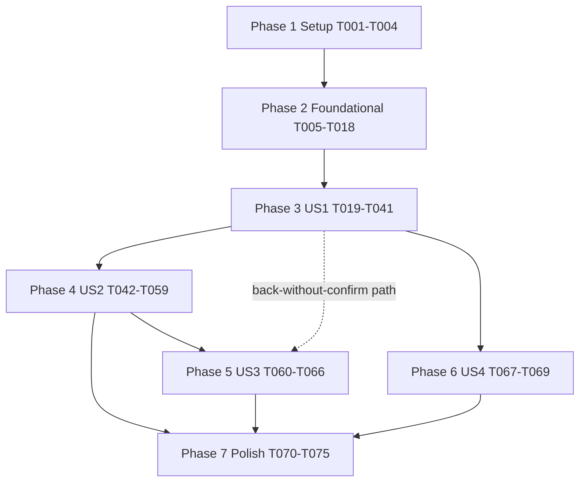

# Tasks: Planner-aware Transfer Explorer

**Input**: [spec.md](spec.md), [plan.md](plan.md), [research.md](research.md), [data-model.md](data-model.md), contracts ([explorer API](contracts/planner-transfer-explorer-api.md), [mutation guard and selectability](contracts/mutation-guard-and-selectability.md), [pinned submission](contracts/pinned-submission.md), [UI navigation](contracts/ui-navigation.md)), [validation guide](quickstart.md), [assessment and risks](current-state-assessment.md), [requirements checklist](checklists/requirements.md).

**Authority**: FR-001 to FR-052, SC-001 to SC-014, resolved Q-1 to Q-3 and Q-6 to Q-8 (Q-4 and Q-5 withdrawn with Duplicate Plan). Phase 002 rules R-01 to R-12 are reused, not changed. The Phase 004 vision is out of scope; no scenario, option or draft concept is built. This document schedules implementation; it does not change the specification.

**Tests**: Required by the constitution (principle IV), the quickstart and the spec's reference scenarios. Within each phase write the listed tests first, observe the expected failure, then implement the owning behaviour, then run the smallest relevant checks before advancing.

**Safety (AGENTS.md, constitution VII)**: Use mise-pinned tools and project-local uv/pnpm dependencies only. Integration tests run only against the dedicated `_test` database through `TEST_DATABASE_URL` and `ensure_test_database_url`, in isolated schemas; never against development data. No Alembic revision, no new dependency, no new service. Do not kill or replace user-owned servers on ports 3000 and 8000; browser verification uses the isolated `.next-copilot` preview with mandatory cleanup. Do not commit, push or open a PR as part of these tasks.

## Format

`- [ ] Tnnn [P?] [USn?] Description with exact path (requirements)`. `[P]` marks tasks on different files with no incomplete prerequisite; it does not skip phase gates.

---

## Phase 1: Setup

**Purpose**: Baseline and shared test support. No production code.

- [X] T001 Establish the baseline before any change: run `mise exec -- make db-test-up`, `mise exec -- make lint typecheck test` and `mise exec -- make test-integration`; record pass counts and any pre-existing failures in the task report (no file changes). Confirm Alembic head is `c6f91a2d83b0`.
- [X] T002 [P] Create API-layer reference-plan and candidate-pool builders in `apps/api/tests/plans/explorer_builders.py`, constructed independently from the public `fpl_engine` models (API tests must not import from `packages/fpl_engine/tests`, and engine tests must not import from `apps/`): plans covering ordinary, Wildcard, Free Hit, Bench Boost and Triple Captain gameweeks; first plan gameweek; starting free transfers 0; estimated (`assumed`) purchase basis; an existing financial shortfall; a transfer acquired earlier in the same gameweek (edit case); and a later planned sale of the outgoing player and a later purchase of a candidate (conflict cases); plus candidate records with selectability flags (`True`, `False`, `None`) and projection rows for `component_v3` (SC-002, SC-012).
- [X] T003 [P] Create the synthetic full-season performance dataset builder in `apps/api/tests/plans/perf_dataset.py`: about 600 players across 20 clubs with realistic selectability flags, one `component_v3` run covering all remaining gameweeks, and an 8-gameweek plan including a Free Hit and later planned transfers; builds only in an isolated schema of the guarded test database (SC-011).
- [X] T004 [P] Create explorer response fixtures for the web in `apps/web/tests/fixtures/planner-explorer.ts` (list and preview payloads matching the contract: available, unavailable, `blocked_by_later_decision`, partial horizon, assumed-continuation blocks, `planning_context`, `commit` descriptor with `guard` and `expected_revision`), reusing `deferred` and `buildPlannerPlan` from `apps/web/tests/fixtures/planner.ts`.

---

## Phase 2: Foundational (blocks every user story)

**Purpose**: Domain analysis primitives, repository support and the planning-context resolver that all stories use. Pure engine code first.

**Checkpoint**: engine and resolver tests green; existing engine and Planner suites unchanged.

- [X] T005 Add regression tests for the non-raising verdict in `packages/fpl_engine/tests/test_planning.py`: for reference plans, the extracted function returns every introduced diagnostic and every new or worsened per-gameweek shortfall, and `validate_candidate` still raises `MutationRejectedError` with the same first diagnostic as today (including the purchase-correction exception). Existing planning tests must pass unmodified (SC-003, FR-016).
- [X] T006 Extract the pure, non-raising verdict from `validate_candidate` in `packages/fpl_engine/src/fpl_engine/planning/mutations.py`; `validate_candidate` calls it and raises exactly as before; `apply_intents` behaviour unchanged (FR-016, FR-033).
- [X] T007 [P] Add tests in `packages/fpl_engine/tests/test_candidate_pool.py` for `incoming_selectability_exclusion`: known non-selectable (either flag `False`, even if the other is `None`) is `player_not_selectable`; any `None` otherwise is `selectability_unknown`; both `True` is `None`; precedence identical to `candidate_pool_exclusion`; playing status is never an input (FR-009, FR-012).
- [X] T008 Extract `incoming_selectability_exclusion` in `packages/fpl_engine/src/fpl_engine/transfers/candidate_pool.py` and make `candidate_pool_exclusion` use it with unchanged results; export from `fpl_engine.transfers` (FR-009, FR-012).
- [X] T009 Write failing domain tests for candidate assessment in `packages/fpl_engine/tests/test_planning_hypothetical.py` (quickstart D1 to D3, D6) using pure reference plans from a new engine-test module `packages/fpl_engine/tests/planning_reference_plans.py` (the same scenario list as T002, built from `fpl_engine` models only; no import from `apps/`): verdict equals `apply_intents` for every pool candidate of each T002 reference plan; operation rule (`edit_transfer` when the outgoing ownership was acquired by a decision in the selected gameweek, otherwise `add_transfer`); states `available` / `unavailable` / `blocked_by_later_decision` with the precedence "selected-gameweek conflict wins"; `sold_this_gameweek` detected before building the plan; validity truncation: structural conflict at gameweek c shows values through c-1, financial conflict at c shows through c and nothing after; Free Hit temporary and Wildcard permanent; selected gameweek is the first plan gameweek; input `Plan` and baseline evaluation unchanged after assessing all candidates (FR-008, FR-010, FR-011, FR-016, FR-018, FR-028, FR-038).
- [X] T010 Implement `packages/fpl_engine/src/fpl_engine/planning/hypothetical.py` (`CandidateQuote`, `TransferOperation`, `Conflict`, `CandidateAssessment`, assessment over in-memory `dataclasses.replace` copies with deterministic `uuid5` decision and ownership identities; baseline evaluated once; no repository imports; money as integer tenths) (FR-013, FR-028, FR-047).
- [X] T011 Write failing domain tests for plan impact in `packages/fpl_engine/tests/test_planning_impact.py` (quickstart D4, D5; reference plans from `planning_reference_plans.py`, extended there as needed): player starting GW7, benched GW8, captain GW9 gives per-gameweek impact using those saved slot roles; Bench Boost and Triple Captain effects; Wildcard carry-forward; Free Hit selected gameweek limits the horizon to that gameweek; impact excludes points hit and reports per-gameweek hit change including free-transfer knock-on effects; horizon past the plan end uses the permanent squad after the final gameweek (restored after a Free Hit) with the final gameweek's saved lineup roles by slot, no chip, no transfers, labelled `assumed_continuation` and totalled separately from `saved_plan`; illegal restored-squad roles give `continuation_lineup_illegal` instead of a repaired lineup; values beyond the validity limit are absent, never estimated (FR-020, FR-021, FR-023, FR-025, FR-026, FR-029, FR-030).
- [X] T012 Implement `packages/fpl_engine/src/fpl_engine/planning/impact.py` (`GameweekImpact`, `PlanImpact` per horizon 1, 3 and 5 with `saved_plan`, `assumed_continuation`, `hit_change`, `net_saved_plan = saved_plan - hit_change`; uses `score_gameweek`; projections passed in as values; coverage is the contiguous run of covered gameweeks starting at N, first gap ends coverage and is reported partial) (FR-021, FR-023, FR-025).
- [X] T013 [P] Add a guarded integration test in `apps/api/tests/repositories/test_my_team_projection_repository_integration.py` for optional `min_gameweek` and `max_gameweek` on `list_player_fixture_projections_for_run`: bounded rows only, unchanged results when omitted, My Team callers unaffected (FR-020, FR-004).
- [X] T014 Add the optional gameweek bounds to `list_player_fixture_projections_for_run` in `apps/api/src/api/repositories/my_team_projection_repository.py` (defaults preserve current behaviour; horizons anchored at the selected gameweek, FR-020, FR-004). The same task adds `FixtureReadRepository.list_schedule` (fixtures in the gameweek range plus unfinished unscheduled ones; guarded test `apps/api/tests/repositories/test_fixture_schedule_repository_integration.py`) used by the analysis service to tell a confirmed blank gameweek from missing data (FR-021, FR-027).
- [X] T015 [P] Add a guarded integration test in `apps/api/tests/repositories/test_squad_player_lookup_repository_integration.py` that lookups return `can_select` and `can_transact` (`None` when unknown) and that existing fields and callers are unchanged (FR-012).
- [X] T016 Add defaulted `can_select` and `can_transact` fields to `SquadPlayerLookupItem` and populate them in `apps/api/src/api/repositories/squad_player_lookup_repository.py`; confirm `_fingerprint` in `apps/api/src/api/services/plans.py` is unaffected (position and team only) (FR-012).
- [X] T017 Write failing tests for the context resolver in `apps/api/tests/plans/test_plan_context.py`: ready plan returns `PlanningContext` with `ContextRef(plan_id, gameweek, revision)`, the linear `Plan`, player rule metadata and the baseline `PlanEvaluation`; each failure yields its explicit error (`plan_not_found`, `plan_not_ready`, `gameweek_not_in_plan`, `evaluation_blocked`, `player_not_in_squad` is raised by analysis not the resolver); the read transaction is ended before return (no plan row lock held, verified on the guarded database); nothing is written (FR-007, FR-047, FR-048).
- [X] T018 Implement `apps/api/src/api/services/plan_context.py`: `resolve_planning_context(plan_id, gameweek)` and the frozen `PlanningContext` / `ContextRef` (holds no repository, session or connection); the only Explorer-path code that reads plan storage; ends the read transaction right after `load_canonical` (FR-047, FR-048).

---

## Phase 3: User Story 1 - Explore replacements in the context of a plan (Priority: P1) MVP

**Goal**: Open the Explorer from a plan gameweek and see ranked candidates computed from the plan's squad, money, chips and projections.

**Independent test**: In a plan whose gameweek 7 squad differs from My Team, open the Explorer from a GW7 player; outgoing player, bank, exclusions, selling price, affordability and horizon labels (GW7, GW7-9, GW7-11) reflect the plan, plan impact and best-XI gain are separate, blocked and unavailable candidates stay visible, and My Team is untouched (US1-1 to US1-16).

### Tests for User Story 1 (write first)

- [X] T019 [P] [US1] Service tests in `apps/api/tests/plans/test_plan_transfer_analysis_service.py` (including missing-player versus missing-gameweek projection regressions: a squad player, later planned acquisition, continuation squad or pool candidate missing in an evaluated gameweek is never zero-filled, and, decided from the fixture schedule, a confirmed blank gameweek, a scheduled fixture without projections for a whole position, an individual player missing a scheduled fixture, a double gameweek needing every fixture, an unscheduled or unimported schedule that does not prove a blank, and gameweeks outside the run's coverage that shorten the horizon) using an in-memory `PlanningContext` and read-only fakes only (no database; the service constructor must accept no plan repository, session or mutation service): pool rules reuse (same position, not in the gameweek squad, selectability; unknown selectability is the refresh-required failure; playing status advisory), run pinning and `newer_run_available`, horizons exactly `N..N+h-1` limited to the contiguous covered subset with `partial` flagged and nothing zero-filled, unavailable states with specific codes (`no_projection_run`, `gameweek_not_projected`, `missing_projections`, `player_not_in_squad` for an outgoing player outside the gameweek squad), ranking by best-XI gain over the primary horizon with ascending `player_id` tie-break and blocked candidates keeping their position, plan impact and assumed continuation, estimated-basis provisional flag, `selling_price_is_approximate` absent, Free Hit horizon limit, integer tenths throughout (quickstart A1, A2, A7; SC-003, SC-005, SC-012, SC-013).
- [X] T020 [P] [US1] Router tests in `apps/api/tests/plans/test_plan_transfers_router.py` for `GET /plans/{plan_id}/gameweeks/{gameweek}/transfers/{player_out_id}`: 200 shape with `planning_context`, error mapping per the contract table (404 `plan_not_found`; 409 `plan_not_ready`; 422 `gameweek_not_in_plan`, `evaluation_blocked`, `player_not_in_squad`, `run_not_found`, `run_model_mismatch`, `selectability_unknown`, `invalid_money`, `invalid_horizon`), `primary_horizon` in {1, 3, 5} only, and that My Team routes are untouched (FR-007, FR-048).
- [X] T021 [P] [US1] Guarded integration test in `apps/api/tests/repositories/test_plan_transfer_explorer_integration.py`: calling the list path leaves row counts, plan `revision`, `updated_at`, `plan_mutations` and My Team rows identical before and after; plan row lock released before ranking (quickstart A3; FR-003, FR-028, SC-004).
- [X] T022 [P] [US1] Web client tests in `apps/web/tests/transfers/planner-explorer-api.test.ts` for the list fetch (types, error codes mapped to unavailable states, `planning_context` retained) (FR-007, FR-048).
- [X] T023 [P] [US1] URL helper tests in `apps/web/tests/transfers/planner-explorer-url.test.ts`: parse and build `/transfers?plan&gw[&out][&h][&run]`; invalid or non-numeric parameters produce an explicit invalid-link result, never My Team mode (FR-001, FR-006).
- [X] T024 [P] [US1] Component tests in `apps/web/tests/transfers/planner-transfer-explorer.test.tsx` for Planner mode list states (SC-006: the run, evaluated gameweeks and missing coverage are always visible): loading, choose-outgoing (no `out`), empty pool, each unavailable code, invalid link, plan missing, plan not ready, candidate states (available, unavailable with reasons, blocked with gameweek), plan-impact column with saved and assumed totals labelled separately, run badge and "newer run available" notice, partial coverage text, Free Hit limit text (quickstart W2; FR-002, FR-007, FR-021, FR-024, FR-026).
- [X] T025 [P] [US1] Entry wrapper test in `apps/web/tests/transfers/transfer-explorer-entry.test.tsx`: `plan` present renders Planner mode; absent renders the existing `TransferExplorer`, whose existing `apps/web/tests/transfers/transfer-explorer.test.tsx` must pass unmodified (quickstart W1; FR-004, SC-010).
- [X] T026 [US1] Add Planner entry-point tests to `apps/web/tests/plans/plan-board.test.tsx`: per-player "Explore transfers" links to `/transfers?plan&gw&out`, a gameweek-level link without `out`, and no change to existing Planner behaviour (FR-005).

### Implementation for User Story 1

- [X] T027 [US1] Define response models in `apps/api/src/api/schemas/plan_transfers.py`: `planning_context`, `plan`, `projection` (horizons list with `requested_gameweeks`, `evaluated_gameweeks`, `saved_plan_gameweeks`, `assumed_gameweeks`, `partial`; `limited_reason`), `accounting_before`, `outgoing`, candidates (`state` in `available` | `unavailable` | `blocked_by_later_decision`, `reasons`, `conflict`, `valid_through_gameweek`, tenths money fields, `best_xi_gain_by_horizon`, `plan_impact_by_horizon`, `fixtures`), error detail `{code, message, missing_player_ids?}` exactly as in [planner-transfer-explorer-api.md](contracts/planner-transfer-explorer-api.md); horizons keyed "1", "3", "5" (FR-021, FR-048).
- [X] T028 [US1] Implement the list analysis in `apps/api/src/api/services/plan_transfer_analysis.py` (`PlanTransferAnalysisService`, constructed from read-only ports only: player read, projection runs and rows, fixture schedule, team difficulty): pool via the engine's `candidate_pool_exclusion` over `PricedPlayer` values built from the planning context's gameweek squad (not the My Team record adapter `incoming_pool_exclusion`) with `pool_exclusion_message` and `selectability_unknown_pool_message` for wording, ranking via `rank_replacement_candidates` unchanged (budget and club-limit flags discarded, `bank=0.0`), assessment via T010, impact via T012, projections bounded to `[N, N+4]` through T014, run pinning via `ProjectionRunRepository`, fixtures and effective difficulty via the existing team read repository, outgoing selling price via `fpl_engine.planning.prices.selling_price_tenths` (FR-008 to FR-011, FR-013 to FR-027, FR-047).
- [X] T029 [US1] Add `apps/api/src/api/routers/plan_transfers.py` composing `resolve_planning_context` then the analysis service, mapping errors per the contract (409 `plan_not_ready`, 422 codes), and register it in `apps/api/src/api/main.py`; My Team routes untouched (FR-007, FR-048).
- [X] T030 [US1] Performance gate for the list in `apps/api/tests/plans/test_plan_transfer_explorer_performance.py` (opt-in via `RUN_PERF_TESTS=1` plus the guarded database): synthetic dataset from T003, midfielder pool, at least 10 timed runs after warm-up through the ASGI app; report median and worst; target list within 3 s; also report a 38-gameweek plan (not gating). Record the numbers (SC-011).
- [X] T031 [US1] (SC-011) Conditional, only if T030 median exceeds 70% of budget: apply the behaviour-preserving levers from [plan.md](plan.md) one at a time (memoise the "before" best-XI per gameweek in ranking; resume replay from the selected gameweek; skip replay for cheap exact exclusions), each with an equality test against the straightforward path and the My Team regression suites unchanged; re-measure. Otherwise mark not needed. **Result (T030, local run, guarded test database, isolated schema): 600 players, 235-candidate midfielder pool, 8-gameweek plan, median 0.75 s, worst 0.89 s over 11 timed runs; a 31-gameweek plan (reported, not gating) median 1.20 s. Below 70% of the 3 s budget, so T031 is not needed and no lever was applied.**
- [X] T032 [US1] Add the list fetch and response types to `apps/web/src/lib/api.ts` (`fetchPlanTransferExplorer`), mapping error codes to unavailable results without falling back to My Team (FR-007).
- [X] T033 [P] [US1] Implement `apps/web/src/lib/planner-explorer-url.ts` (parse and build helpers from T023) (FR-001, FR-006).
- [X] T034 [US1] Generalise the `players` prop type of `apps/web/src/components/transfers/outgoing-player-selector.tsx` to the minimal structural fields it uses (`player_id`, `web_name`, `position`, `team_short_name`) with no behaviour change; existing tests unchanged (FR-005).
- [X] T035 [P] [US1] Create `apps/web/src/components/transfers/planner/planner-context-banner.tsx` (mode "Planner mode", plan name, gameweek, "Back to plan") (FR-002).
- [X] T036 [US1] Create `apps/web/src/components/transfers/planner/planner-candidate-table.tsx` (columns: Player, Team, Price, Resulting bank, best-XI gain 1/3/5, plan impact for the selected horizon with saved and "Assumed continuation (no plan decisions)" totals never summed, state chip, Preview button placeholder; unavailable reasons via `describeLegalityReasons`; advisory status via `playingStatusWarning`; "Estimated" indicator; no filters yet) (FR-011, FR-015, FR-016, FR-023).
- [X] T037 [US1] Create `apps/web/src/components/transfers/planner/planner-transfer-explorer.tsx` (SC-001: from a plan gameweek player to the list without re-selecting plan, gameweek or player; list-phase state machine, `commit` prop declared for later, stale-response ignoring on outgoing or horizon change, run pinning via `run` parameter, `HorizonSelector` and `ProjectionRunBadge` reuse) (FR-001, FR-002, FR-006, FR-024).
- [X] T038 [US1] Create `apps/web/src/components/transfers/transfer-explorer-entry.tsx` and change `apps/web/src/app/transfers/page.tsx` to render it inside the existing `Suspense`; leave `transfer-explorer.tsx` untouched (FR-004).
- [X] T039 [US1] Add Planner entry points in `apps/web/src/components/plans/plan-board.tsx`: pass `transferHref` (`/transfers?plan&gw&out`) to `SquadPlayerCard` for squad cards and add "Explore transfers for this gameweek" to the gameweek header; no other Planner behaviour change (FR-005).
- [X] T040 [US1] Playwright (mocked API, existing `installPlanner` style) journey in `apps/web/tests/e2e/planner-transfer-workflow.spec.ts`: Planner to Explorer list at 1440 and 390 widths showing mode banner, run badge, horizon labels, blocked and unavailable candidates (quickstart B1 first part).
- [X] T041 [US1] Checkpoint: run existing My Team Explorer, ranking and Planner suites (`apps/api/tests/transfers`, `apps/api/tests/team`, `apps/web/tests/transfers/transfer-explorer.test.tsx`, `apps/web/tests/team`, `apps/web/tests/plans`) and confirm they pass unmodified (FR-004, SC-010).

**Checkpoint**: US1 is independently usable (explore and compare, read-only).

---

## Phase 4: User Story 2 - Preview and commit a planned transfer (Priority: P1)

**Goal**: Preview a replacement read-only and confirm it into the plan through the existing writer, pinned to the previewed revision.

**Independent test**: Preview a transfer, confirm nothing is saved, then confirm it; the reopened plan matches a hand calculation, My Team is unchanged, a competing edit between preview and confirm forces a fresh preview, and success is shown only for the Explorer's own mutation (US2-1 to US2-24).

**Depends on**: US1 (list UI and analysis service), Phase 2.

### Tests for User Story 2 (write first)

- [X] T042 [P] [US2] Mutation tests in `apps/api/tests/plans/test_plan_mutation_guard.py` (service and router cases; the shared `seed_planner_players` helper in `apps/api/tests/conftest.py` now seeds selectable players because unknown selectability is rejected on write): optional `expected_outgoing_market_tenths` and `expected_incoming_price_tenths` are both-or-neither, positive integer tenths not above `MAX_PRICE_TENTHS`; mismatch gives 422 `prices_changed` with a diagnostic and no receipt; matching guard commits at server-captured prices (browser values never stored); guard is part of the digest and a same-ID retry resumes without re-running the comparison; selectability: `add_transfer` and `edit_transfer` that changes the incoming player reject `player_not_selectable` / `selectability_unknown`, an edit leaving the incoming player unchanged is not checked, saved decisions replay without checks, playing status never rejects (quickstart A4, A5; FR-012, FR-033).
- [X] T043 [P] [US2] Preview service tests (including a financial-conflict gameweek that is kept but not valid) appended to `apps/api/tests/plans/test_plan_transfer_analysis_service.py`: per-gameweek accounting before and after, hit change and net, Free Hit temporary, Wildcard hit-free and permanent, Bench Boost and Triple Captain ordinary accounting, add versus edit descriptor and `commit.intent`, `guard`, `expected_revision` equal to `planning_context.revision`, blocked candidate shows values through the validity limit with the conflicting gameweek and decision and `confirmable: false`, a not-in-pool player is 422 `player_not_in_candidate_pool` (quickstart D2, D3; FR-028 to FR-031, FR-038, FR-048).
- [X] T044 [P] [US2] Router tests appended to `apps/api/tests/plans/test_plan_transfers_router.py` for `.../preview`: 200 for unavailable and blocked candidates, 404 `player_not_found`, `projection_run_id` pinning, same error table (FR-048).
- [X] T045 [P] [US2] Extend `apps/api/tests/repositories/test_plan_transfer_explorer_integration.py`: the preview's commit intent, guard and expected revision are posted unchanged for an add and a same-gameweek edit and the resulting finances and squad match the preview; preview writes nothing; Explorer-originated confirm followed by GET plan recalculates later gameweeks; My Team squad, bank and free transfers byte-identical afterwards; a stale `expected_revision` is 409 `revision_conflict` with nothing written (quickstart A3, A6, A8; FR-036, FR-037, SC-004).
- [X] T046 [P] [US2] Coordinator pinned-submission tests in `apps/web/tests/plans/plan-save-coordinator-pinned.test.ts` implementing quickstart C1 to C17 and C19 to C21 against [pinned-submission.md](contracts/pinned-submission.md) with deferred promises (envelope `expected_revision` equals the pinned value; refusals `stale_preview`, `busy`, `pinned_exists`; success only for the pinned mutation identity regardless of unrelated revision changes; `committed`, `rejected`, `conflict`, `unknown`, `pending_unsaved`, `plan_missing`; `abandon()` table including refusal for `sending` and `unknown`; `reconcile()`, same-identity `retry()`; `revalidate()` never replays; queued and overlapping Planner edits never discarded and resumed against the refreshed plan; navigation persistence and `hasUnsavedWork()` values; `abandon()` on `pending_unsaved` sends no mutation or receipt request, reports `serverReceiptRetained: true`, leaves the refreshed plan without the transfer and never yields `committed`; `rejected` (including `prices_changed`) is cleared by `abandon()` with no server contact and returns the cleared record, `submitPinned` is refused `pinned_exists` until it is cleared, a fresh `submitPinned` then uses a new mutation identity, nothing is ever resubmitted automatically and an unacknowledged rejection never blocks Planner edits) (FR-034, FR-035, FR-041, FR-049 to FR-052, SC-014).
- [X] T047 [US2] Add to `apps/web/tests/plans/plan-board.test.tsx` a case where the coordinator holds a pinned `conflict` and the user presses "Revalidate With Current Data": nothing is replayed and the pinned submission is abandoned; also confirm the unmodified `apps/web/tests/plans/plan-save-coordinator.test.ts` passes (quickstart C18; FR-052).
- [ ] T048 [P] [US2] Component tests in `apps/web/tests/transfers/planner-transfer-preview.test.tsx`: preview panel above the table; saved-plan and assumed-continuation blocks separate; totals not summed; hit, net and later-gameweek consequences; blocked candidate shows valid values only and the clash, no repair controls; Confirm wording distinct from preview; Confirm disabled when `confirmable` is false, when a pinned submission exists, when the coordinator is busy, or when the acknowledged revision differs from the preview's (shows "Plan changed, preview again"); success only for the Explorer's own `submissionId`; `prices_changed` triggers a fresh preview and no resubmit; conflict offers "Refresh and preview again" (abandon); unknown offers "Check save status" and "Retry same transfer" and no abandon; accepted-but-not-saved shows the warning next to "Stop tracking this transfer", afterwards the not-added notice, with no text claiming the transfer was saved, cancelled, deleted or removed, no navigation or highlight, and a fresh preview required (W8); a rejection keeps its message above the fresh preview, clears the record, never resubmits, and Confirm needs a new click that makes a new submission; a terminal record found on mount is shown once and cleared (W9) (quickstart W4, W5, W8, W9; FR-029 to FR-035, FR-049 to FR-051).

### Implementation for User Story 2

- [X] T049 [US2] Add the optional guard fields to the `add_transfer` and `edit_transfer` models in `apps/api/src/api/schemas/plans.py` (both-or-neither, positive integer tenths, `MAX_PRICE_TENTHS` bound; additive; existing tests unchanged) (FR-033).
- [X] T050 [US2] In `apps/api/src/api/services/plans.py` `_capture`: compare the guard with the freshly captured prices before any receipt and raise `MutationRejectedError` with a `prices_changed` diagnostic; check incoming selectability (via T008 and T016) for added transfers and edits that change the incoming player, rejecting with `player_not_selectable` or `selectability_unknown`; saved decisions are never re-checked; no browser value is stored (FR-012, FR-033).
- [X] T051 [US2] Add preview analysis to `apps/api/src/api/services/plan_transfer_analysis.py` and the preview schema in `apps/api/src/api/schemas/plan_transfers.py` (per-gameweek table with `basis`, `valid`, accounting before and after, `squad_changed`, `incoming_role`, points before, after and delta excluding hit, totals per horizon, `lineup_effect`, `best_xi`, `commit` with `intent`, `guard`, `expected_revision`) (FR-028 to FR-031, FR-048).
- [X] T052 [US2] Add the preview route to `apps/api/src/api/routers/plan_transfers.py` (200 for unavailable and blocked candidates with `confirmable: false`; `player_not_in_candidate_pool`; `projection_run_id`) (FR-016, FR-030).
- [X] T053 [US2] Preview performance gate appended to `apps/api/tests/plans/test_plan_transfer_explorer_performance.py`: target individual preview within 2 s on the T003 dataset; record median and worst; apply T031 levers only if over 70% of budget (SC-011). **Result: median 0.075 s, worst 0.111 s over 11 runs (same dataset), no lever needed.**
- [X] T054 [US2] Implement the pinned submission in `apps/web/src/lib/plan-save-coordinator.ts` exactly per [pinned-submission.md](contracts/pinned-submission.md): `submitPinned` (preconditions in order, never enqueues, envelope `expected_revision` = the pinned value), `snapshot.pinned` and status mapping, outcome transitions, `abandon()` (discards only the pinned envelope, refresh-first for `conflict` and `pending_unsaved`, refuses `sending` and `unknown`, never touches the queue; returns `AbandonResult` with `previous` and `serverReceiptRetained`, true only for `pending_unsaved`, which calls no mutation or receipt endpoint; clears a `rejected` record without server contact and recomputes the Planner `error` status; a terminal record is cleared only by `abandon()`, never silently replaced by `submitPinned`), `revalidate()` guard so it never replays a pinned submission; all new paths gated on a pinned active envelope so existing behaviour is unchanged (FR-034, FR-049 to FR-052).
- [ ] T055 [P] [US2] Add the preview fetch, the guard fields on `PlanIntent` add and edit variants, and `PinnedSubmission` types to `apps/web/src/lib/api.ts` and extend `apps/web/tests/transfers/planner-explorer-api.test.ts` (FR-033, FR-048, FR-049).
- [ ] T056 [US2] Create `apps/web/src/lib/planner-commit.ts`, the default `commit` adapter: wraps `getPlanSaveCoordinator(plan).submitPinned` with the preview's descriptor and `expected_revision`, exposes status derived only from `snapshot.pinned` for its own `submissionId` (FR-032, FR-048, FR-050).
- [ ] T057 [US2] Create `apps/web/src/components/transfers/planner/planner-transfer-preview.tsx` (per-gameweek table with a visibly separated "Assumed continuation (no plan decisions)" block, totals, hit and net, conflict explanation, commit region "Add to plan GW n") (FR-029 to FR-031).
- [ ] T058 [US2] Integrate preview and commit into `apps/web/src/components/transfers/planner/planner-transfer-explorer.tsx`: stale marking on any acknowledged-revision change, Confirm gating, success only from the own pinned record, on any rejection keep the message from `previous`, clear the record with `abandon()`, load a fresh preview (automatic for `prices_changed`) and never resubmit, `abandon()` then reload and re-preview on conflict, reconcile and same-identity retry on unknown, "Stop tracking this transfer" for accepted-but-not-saved with the required warning and not-added notice (never worded as saved, cancelled or removed), acknowledge any terminal record found on mount, distinct states for rejected, not saved, unknown and conflict (FR-031 to FR-035, FR-042, FR-049 to FR-051).
- [ ] T059 [US2] Playwright journeys in `apps/web/tests/e2e/planner-transfer-workflow.spec.ts`: B3 blocked candidate (previewable, gameweek named, Confirm disabled, no repair); B4 prices changed between preview and confirm (guarded harness updates a stored price): rejected, message retained, fresh preview with new prices, nothing saved or resubmitted automatically, an explicit second Confirm then saves a new submission; B5 save failure (including accepted-but-not-saved and stopping tracking it: warning first, plan unchanged, notice never reads as saved, cancelled or removed), conflict and a competing Planner edit committed between preview and confirm: same-identity retry, fresh preview required, never submitted against the newer revision; mocked and guarded real-API variants at 1440 and 390 (quickstart B3 to B5).

**Checkpoint**: US1 and US2 deliver the full explore, preview and confirm loop.

---

## Phase 5: User Story 3 - Return to the plan with context and consequences (Priority: P2)

**Goal**: Return to the same plan and gameweek with the changed player highlighted, with context surviving reloads, departure protection and unresolved submissions.

**Independent test**: Confirm a transfer in gameweek 9; the Planner reopens on GW9 with the incoming player marked and in view, later gameweeks recalculated and a notice; Back without confirming returns to the same gameweek unchanged; reload inside the Explorer restores context (US3-1 to US3-7, US2-21).

**Depends on**: US2 for the confirm path; the back-without-confirming path works after US1.

### Tests for User Story 3 (write first)

- [ ] T060 [P] [US3] Tests for the extracted departure guard in `apps/web/tests/plans/use-departure-guard.test.tsx` (same behaviours as today: link-click confirm, `beforeunload`, history Back and Forward guard), and keep the existing `plan-board.test.tsx` departure tests passing unmodified (quickstart W7; FR-041).
- [ ] T061 [P] [US3] Planner arrival tests in `apps/web/tests/plans/plan-board.test.tsx`: `?gw` and `?highlight` honoured on arrival only, default gameweek unchanged without them, highlighted card scrolled into view once with reduced-motion respected, one-shot `sessionStorage` notice read and cleared, `history.replaceState` to `?gw={n}` only when launching the Explorer (FR-039, FR-040).
- [ ] T062 [P] [US3] Explorer navigation tests appended to `apps/web/tests/transfers/planner-transfer-explorer.test.tsx`: navigate to `/plans/{id}?gw&highlight` only after the own pinned record is `committed` (then `abandon()` clears it); "Back to plan" and browser Back leave the plan unchanged; reload and deep link restore plan, gameweek, outgoing player, horizon and pinned run; unresolved pinned submission shown again on return; departure warning while `sending`, `unknown`, `pending_unsaved` or `conflict`; an unacknowledged `rejected` or `committed` record found on mount is shown once and cleared without starting a submission or navigating (FR-034, FR-039, FR-041, FR-051).

### Implementation for User Story 3

- [ ] T063 [US3] Extract the unsaved-work protection effect from `apps/web/src/components/plans/plan-board.tsx` into `apps/web/src/lib/use-departure-guard.ts` unchanged in behaviour and use it from `plan-board.tsx` (FR-041).
- [ ] T064 [US3] Implement arrival handling in `apps/web/src/components/plans/plan-board.tsx` (`gw`, `highlight`, notice, replaceState on explore) and add an optional highlighted state and `data-player-id` hook to `apps/web/src/components/team/squad-player-card.tsx` without changing existing rendering when unset (FR-039, FR-040).
- [ ] T065 [US3] Implement navigation in `apps/web/src/components/transfers/planner/planner-transfer-explorer.tsx`: use `use-departure-guard`, push to `/plans/{id}?gw&highlight` after the own committed record, write the one-shot notice ("Transferred X for Y in GW n"), "Back to plan" link, context restored from the address (FR-006, FR-039, FR-041).
- [ ] T066 [US3] Playwright journeys in `apps/web/tests/e2e/planner-transfer-workflow.spec.ts` (SC-001: player to saved transfer without re-selecting plan, gameweek or player): B1 complete loop (same gameweek, highlighted incoming player in view, notice, later gameweeks changed, My Team unchanged); B2 reload, new tab, Back and Forward inside the Explorer; navigating away and back with an unresolved submission; at 1440 and 390 (FR-039 to FR-041, SC-007, SC-008).

**Checkpoint**: Context and unsaved work are never lost across the Explorer and Planner.

---

## Phase 6: User Story 4 - Compare replacement options efficiently (Priority: P3)

**Goal**: Search, filter, sort and fixtures over server-computed candidates.

**Independent test**: With a realistic pool, search a name, filter to affordable candidates from one club, sort by price and 3-gameweek gain; results, order and fixture columns are correct and no domain value is recomputed in the browser (US4-1 to US4-6).

**Depends on**: US1 (table and data). Independent of US2 and US3.

- [ ] T067 [P] [US4] Component tests in `apps/web/tests/transfers/planner-candidate-table.test.tsx`: name search; filters by club, maximum price, "available to apply only", playing status; sorts by gain at 1, 3 and 5, price, resulting bank and fixture difficulty with stable `player_id` tie-break; visible and clearable active filters and sort; empty state; default order equals server order; fixtures over the horizon (opponent, home or away, difficulty) starting at the selected gameweek; no legality, money, gain or fixture recomputation (quickstart W3; FR-043 to FR-046).
- [ ] T068 [US4] Implement search, filters, sorts and fixture display in `apps/web/src/components/transfers/planner/planner-candidate-table.tsx` as presentation over server results only; no saved filters, no comparison panels (FR-043 to FR-046).
- [ ] T069 [US4] Playwright smoke in `apps/web/tests/e2e/planner-transfer-workflow.spec.ts`: search, filter and sort on a realistic pool at 1440 and 390 (SC-009).

---

## Phase 7: Polish and cross-cutting verification

**Purpose**: Gates, evidence and independent review. No new behaviour.

- [ ] T070 Run `mise exec -- make lint`, `mise exec -- make typecheck`, `mise exec -- make test` and `mise exec -- make test-integration`; all existing suites pass unmodified and the new suites pass; report counts against the T001 baseline (SC-010, SC-014).
- [ ] T071 Record final performance evidence: re-run T030 and T053 on the T003 dataset; report median and worst for list and preview and the 38-gameweek plan (reported, not gating); state clearly any optimisation applied from T031 (SC-011).
- [ ] T072 Browser verification per `.github/skills/ui-browser-verification/SKILL.md`: `make frontend-verify-build`, `make frontend-verify-preview FRONTEND_VERIFY_PORT=3100` (or another unused port), run the Playwright spec and inspect rendered pages at 1440x900 and 390x844 for quickstart B1 to B6 including the unchanged My Team Explorer; then `make frontend-verify-clean` and confirm the preview process exited and `.next-copilot` is absent. Report exactly what was and was not exercised (SC-007, SC-010).
- [ ] T073 Confirm scope boundaries (constitution II, VIII; spec Out of Scope): `git diff` shows no change under `apps/api/alembic/`, no dependency, lockfile or toolchain change, no Duplicate Plan or Phase 004 artefacts, and Alembic head still `c6f91a2d83b0`.
- [ ] T074 Independent review (constitution V, X) using `.github/skills/code-review/SKILL.md` against the spec, contracts and constitution; resolve relevant findings; inspect the final `git diff` for unintended changes.
- [ ] T075 Produce the completion report required by AGENTS.md and constitution X: files changed, decisions and trade-offs, checks and browser verification performed, performance numbers, known limitations, anything not verified, and whether the final diff was reviewed. Do not commit, push or open a PR unless asked.

---

## Dependencies and execution order

- Within Phase 2: T005 to T006 (verdict) before T009 to T010 (hypothetical); T007 to T008 independent; T009 to T012 sequential in the engine (impact needs the types from hypothetical); T013 to T016 independent repository work; T017 to T018 need T010 and T012 types.
- US1 API (T019 to T031) can proceed in parallel with US1 web tests and helpers (T022 to T026, T032 to T035) once the contract fixtures (T004) exist; T036 to T038 need T032 and T034 to T035; T039 needs T038 only for end-to-end.
- US2: T054 (coordinator) is independent of the API tasks T049 to T052 and can run in parallel; T056 to T058 need T054, T055 and T051 to T052.
- US4 can run in parallel with US2 and US3 after US1.

## Parallel opportunities

- Setup: T002, T003, T004 together.
- Phase 2: T007 with T005; T013 and T015 with the engine tasks.
- US1 tests: T019, T020, T021, T022, T023, T024, T025 together (different files).
- US2: API tests T042 to T045, coordinator tests T046 and component tests T048 together; implementation T049 to T053 (API) alongside T054 to T055 (web coordinator and client).
- US4 (T067 to T069) alongside US2 and US3 by a second contributor.

## Implementation strategy

1. **MVP**: Setup, Foundational, US1: a read-only, plan-aware Explorer (explore and compare) with the performance gate measured early (T030).
2. **Core value**: add US2 (preview and pinned commit). The coordinator work (T046, T054) is the highest-risk change to existing code and should land with its full test matrix before the Explorer UI depends on it.
3. **Completion**: US3 (navigation, guard, highlight), then US4 (comparison controls), then Polish.
4. Run the smallest relevant checks after each task group; run the existing My Team and Planner suites at each checkpoint (T041, T047, T070).
5. Stop and report at any checkpoint if a Phase 002 guarantee appears to be affected; do not weaken an existing test.

## Requirement coverage

| Requirements | Tasks |
|---|---|
| FR-001 to FR-007 | T017, T018, T020, T023, T024, T025, T027 to T029, T033, T035, T037, T038, T039 |
| FR-008 to FR-012 | T007 to T010, T015, T016, T019, T028, T042, T050 |
| FR-013 to FR-019 | T009, T010, T019, T028, T036 |
| FR-020 to FR-027 | T011, T012, T013, T014, T019, T028, T036, T037 |
| FR-028 to FR-031 | T009, T021, T043, T045, T051, T052, T057 |
| FR-032 to FR-038 | T042, T043, T045, T046, T050, T054, T056, T058 |
| FR-039 to FR-042 | T060 to T066 |
| FR-043 to FR-046 | T067 to T069 |
| FR-047, FR-048 | T010, T017, T018, T019, T020, T027, T029, T043, T051, T056 |
| FR-049 to FR-052 | T046, T047, T048, T054, T058, T059, T062 |
| SC-001 to SC-014 | SC-001/002 T002, T009, T019; SC-003 T005, T009, T019, T042; SC-004 T021, T045; SC-005 T011, T019; SC-006 T024; SC-007/008 T062, T066, T059; SC-009 T067, T069; SC-010 T025, T041, T070, T072; SC-011 T003, T030, T053, T071; SC-012 T011, T019, T043; SC-013 T019, T028; SC-014 T046, T047, T054, T059 |
